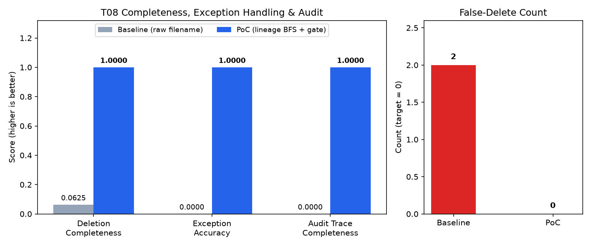
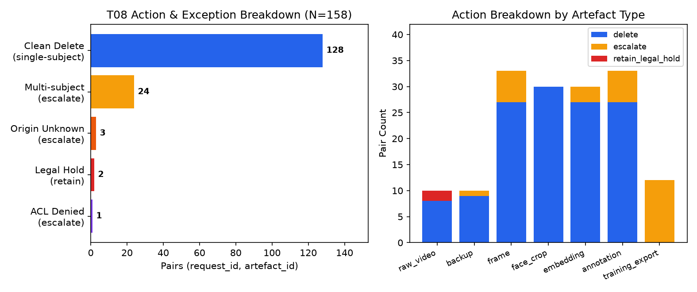

# Demo Deck — Day 06 · Track T08 (`Retention & Delete Request Simulator`)

- **Học viên:** `VuVanThang` (`2A202603239`)
- **Repository:** `https://github.com/Yusei1708/K5-L2-DAY06-VuVanThang-2A202603239-DataGovernanceAndPrivacy`
- **Tags:** `demo-180m`, `final-24h`

---

## Slide 1 · Bài toán & Rủi ro Quản trị Dữ liệu (T08)

- **Bối cảnh:** Tiếp nhận `10` yêu cầu xóa (`DR-001`..`DR-010`) trên đồ thị `212` artefact phân tầng từ video gốc đến dữ liệu dẫn xuất (`raw_video -> backup / frame -> face_crop -> embedding / annotation -> training_export`).
- **Vì sao cách xóa đơn giản theo tên file thất bại?**
  - **Sót bản dẫn xuất:** Xóa `drive_subj_XX_0XX.mp4` bỏ sót `93.75%` artefact cần xóa (`120/128` bản `backup`, `frame`, `face_crop`, `embedding`, `annotation`).
  - **Xóa nhầm Legal Hold:** Xóa thẳng `a0043` (`LH-2026-03`) và `a0099` (`LH-2026-07`), vi phạm nghĩa vụ bảo toàn chứng cứ (`False-delete = 2`).
  - **Nguy cơ nhiễu chủ thể khác:** `frame` chung 2 người (`a0011` chứa `subj_00, subj_01`) nối tới `face_crop` riêng (`a0012` của `subj_00`).

---

## Slide 2 · Kiến trúc PoC (`src/t08_deletion.py` & `src/pipeline.py`)

1. **01 `load()`:** Xác thực toàn vẹn `manifest.csv` bằng SHA256 (`strict_provenance: true`), tải `data_graph.json` và `requests.json`.
2. **02 `process()`:**
   - **Subject-aware Lineage BFS:** Duyệt đồ thị con từ nguồn theo cạnh `parent_ids -> children`, chặn bước vào nhánh con chứa `subject_ids` khác chủ thể yêu cầu.
   - **Tháp ưu tiên chính sách:** `legal_hold` (`1.00`) > `permission/acl` (`0.95`) > `origin_known=false` (`0.90`) > `multi_subject` (`0.85/0.80`) > `clean_delete` (`<= 0.15`).
   - **Checkpoint & Idempotency:** Lưu `checkpoint_state.json` sau từng request, hỗ trợ `resume` khi ngắt job và bảo đảm chạy lặp 2 lần ra kết quả y hệt.
3. **03 `rank()`:** Đưa toàn bộ `30` ca ngoại lệ lên `review_queue.csv` + `contact_sheet.html` (offline).
4. **04 `review()` & 05 `decide()`:** Áp quyết định duyệt từ `review_queue_reviewed.csv`, ghi `audit_log.jsonl` cấp từng artefact (`346` entries sau 2 pha), xuất `dry_run_summary.json`, `sla_dashboard.html`, `notifications.jsonl`, và chuyển cổng `HOLD -> GO` trong `decision_log.csv`.

---

## Slide 3 · Kết quả Định lượng: Baseline vs PoC



| Chỉ số (đối chiếu nội bộ `N = 158`, `seed = 42`, `--offline`) | Baseline | PoC | Cải thiện |
|---|---:|---:|---|
| **Deletion Completeness** *(chính, higher)* | `0.0625` (`8/128`) | **`1.0000` (`128/128`)** | **`+0.9375` (`+1500.0%`)** |
| **False-delete count** *(target = 0, lower)* | `2` | **`0`** | **`-2` (`-100.0%`)** |
| **Exception handling accuracy** *(higher)* | `0.0000` (`0/30`) | **`1.0000` (`30/30`)** | **`+1.0000`** |
| **Audit trace completeness** *(higher)* | `0.0000` (`0/10`) | **`1.0000` (`158/158`)** | **`+1.0000`** |
| **Runtime / 100 items** *(s, lower)* | `0.2430s` | **`0.0433s`** | Nhanh gấp `5.6x` |

---

## Slide 4 · Phân bố Ngoại lệ, HITL Review & SLA Dashboard



- **`128` Delete hợp lệ:** Đủ 6 tầng đơn chủ thể (`8` raw, `9` backup, `27` frame, `30` face_crop, `27` embedding, `27` annotation).
- **`2` Retain Legal Hold:** `DR-002:a0043` (`LH-2026-03`) và `DR-005:a0099` (`LH-2026-07`).
- **`28` Escalate cần xử lý chuyên biệt:** `1` thiếu ACL (`a0156` của `vendor-x`), `3` mất nguồn gốc (`a0075/a0079/a0083`), `12` frame/annotation 2 người, `12` liên kết `training_export` (`a0211/a0212`).
- **Tài liệu vận hành sau chạy:** Mở offline `out/poc/contact_sheet.html` để duyệt ca ngoại lệ và `out/poc/sla_dashboard.html` để theo dõi hạn `30` ngày của từng request.

---

## Slide 5 · Chạy Demo Offline bằng 1 Lệnh

```bash
make preflight && make verify
.venv/bin/python -m src.main --track t08 --pipeline src.baseline_t08 --output out/baseline --run-name baseline --offline --seed 42
.venv/bin/python -m src.main --input fixtures/t08_deletion --config configs/lab.yaml --output out/poc --offline --seed 42
cp reports/review_queue.csv out/poc/review_queue_reviewed.csv
.venv/bin/python -m src.main --input fixtures/t08_deletion --config configs/lab.yaml --output out/poc --offline --seed 42
.venv/bin/python -m pytest -q
```
